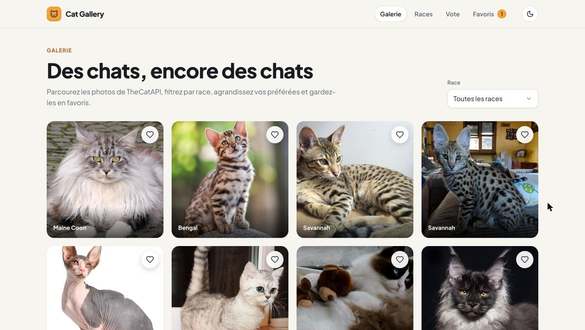
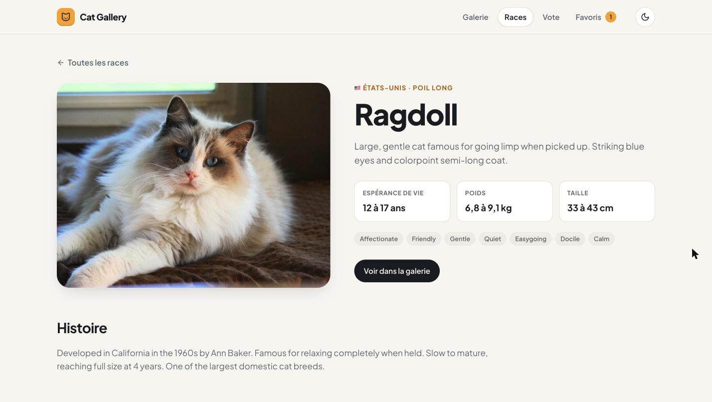
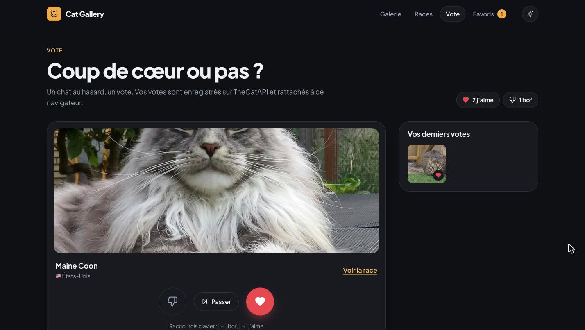
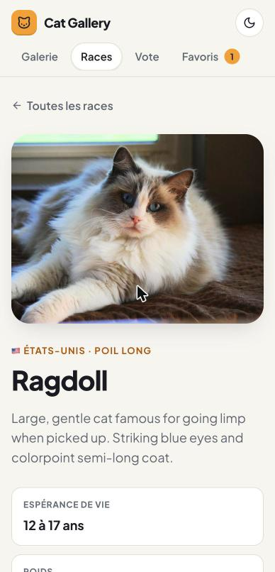

# Cat Gallery

[](https://github.com/AirKyzzZ/cat-gallery/actions/workflows/ci.yml)

Galerie de chats en React 19 construite sur [TheCatAPI](https://thecatapi.com). Projet du cours React du module DEVE515 « JavaScript et Framework JS », BAC+3 CDA DevFS, EPSI Bordeaux 2026-2027.



## Fonctionnalités

- **Galerie** : flux aléatoire de photos, filtre par race synchronisé avec l'URL (`/?race=beng`), pagination « Voir plus », squelettes de chargement.
- **Visionneuse** : agrandissement plein écran, navigation au clavier (← → Échap), lien vers la fiche de la race, favori en un clic.
- **Encyclopédie des races** : 107 races, recherche (nom et noms alternatifs, sans tenir compte des accents), filtres par pelage et par origine, quatre tris. Les filtres vivent dans l'URL, on peut donc partager une recherche.
- **Fiche race** : description, histoire, espérance de vie, poids, taille, tempérament, drapeau et pays d'origine traduits en français, galerie dédiée.
- **Vote** : un chat au hasard, « j'aime » ou « bof » (boutons ou flèches du clavier), score et historique des derniers votes.
- **Favoris** : ajout et retrait synchronisés avec TheCatAPI, compteur dans l'en-tête, page dédiée.
- **Thème clair / sombre** : suit la préférence du système, mémorisé dans le navigateur, sans flash au chargement.
- **Responsive et accessible** : navigation au clavier, focus visible, lien d'évitement, libellés ARIA, `prefers-reduced-motion` respecté.
- **Gestion d'erreurs** : messages compréhensibles (clé refusée, quota dépassé, réseau coupé) et bouton « Réessayer » partout.

| Fiche race | Vote (thème sombre) | Mobile |
| --- | --- | --- |
|  |  |  |

## Stack

| Besoin | Choix |
| --- | --- |
| UI | React 19 (`use`, `<Context value>`, `<title>` dans les composants) |
| Routage | React Router 8, mode data (`createBrowserRouter`, `ErrorBoundary`, `ScrollRestoration`) |
| Build | Vite 6 |
| Styles | CSS natif avec variables (design tokens), aucun framework CSS |
| Tests | Vitest, Testing Library, jsdom |
| Qualité | ESLint 10 avec `eslint-plugin-react-hooks` 7 (règles du React Compiler) |
| CI/CD | GitHub Actions, déploiement GitHub Pages, Dependabot |

## Démarrer

Prérequis : Node.js 22.22 ou plus récent (voir `.nvmrc`) et une clé gratuite sur [thecatapi.com](https://thecatapi.com/signup).

```bash
git clone https://github.com/AirKyzzZ/cat-gallery.git
cd cat-gallery
npm install
cp .env.example .env   # puis collez votre clé dans VITE_CAT_API_KEY
npm run dev
```

L'application est servie sur http://localhost:5173. Sans clé, elle refuse de démarrer avec un message explicite dans la console.

## Scripts

| Commande | Rôle |
| --- | --- |
| `npm run dev` | Serveur de développement avec rechargement à chaud |
| `npm run build` | Build de production dans `dist/` |
| `npm run preview` | Sert le build de production en local |
| `npm run lint` | ESLint sur tout le projet |
| `npm test` | Lance la suite de tests une fois |
| `npm run test:watch` | Tests en mode surveillance |

## Organisation du code

```
src/
├── components/   composants réutilisables (grille, carte, visionneuse, en-tête…)
├── context/      contextes partagés (races, favoris) et leur provider
├── hooks/        logique d'état et d'appels API (useCatImages, useFavourites, useVoting…)
├── pages/        un composant par route
├── services/     client TheCatAPI et classe ApiError
├── utils/        fonctions pures (filtres et tris des races, messages d'erreur, sub_id)
├── test/         configuration, fixtures et helper de rendu des tests
├── routes.js     table des routes
└── main.jsx      point d'entrée
```

Les choix d'architecture sont détaillés dans [docs/ARCHITECTURE.md](docs/ARCHITECTURE.md), le cahier des charges dans [docs/SPECIFICATIONS.md](docs/SPECIFICATIONS.md).

## Tests

60 tests répartis en trois niveaux :

- **Unitaires** : filtres, tris, formatage des races, traduction des erreurs (`src/utils`).
- **Service** : construction des requêtes, en-têtes, pagination et erreurs du client TheCatAPI, avec `fetch` simulé (`src/services`).
- **Hooks et intégration** : pagination, favoris optimistes, puis parcours complets dans l'application routée (navigation, filtres, visionneuse au clavier, favoris, vote, 404, reprise après erreur) avec l'API simulée (`src/hooks`, `src/App.test.jsx`).

```bash
npm test
```

## CI/CD

Le workflow [`.github/workflows/ci.yml`](.github/workflows/ci.yml) tourne sur chaque push et pull request :

1. **Qualité** : `npm ci`, lint, tests, build.
2. **Déploiement** : sur `main` uniquement, si le secret `VITE_CAT_API_KEY` est configuré, le build est publié sur GitHub Pages. Le fichier `404.html` est une copie de `index.html` pour que les routes profondes fonctionnent.

Dependabot propose chaque semaine les mises à jour npm et chaque mois celles des actions GitHub.

## Sécurité

La clé TheCatAPI est lue côté client (`VITE_CAT_API_KEY`) : elle n'est jamais commitée (`.env` est ignoré) mais elle se retrouve dans le JavaScript d'un build déployé. C'est acceptable pour une clé gratuite et limitée à des données publiques. Pour un vrai produit, il faudrait un petit proxy serveur qui garde la clé et vérifie le `sub_id`.

## Auteur

Maxime Mansiet, EPSI Bordeaux.
